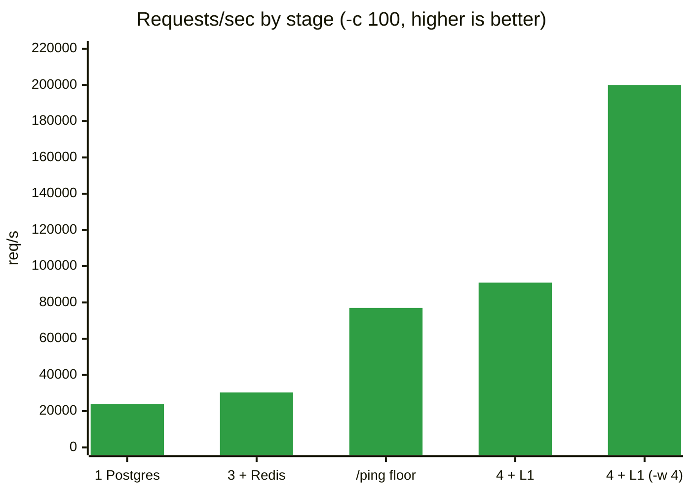
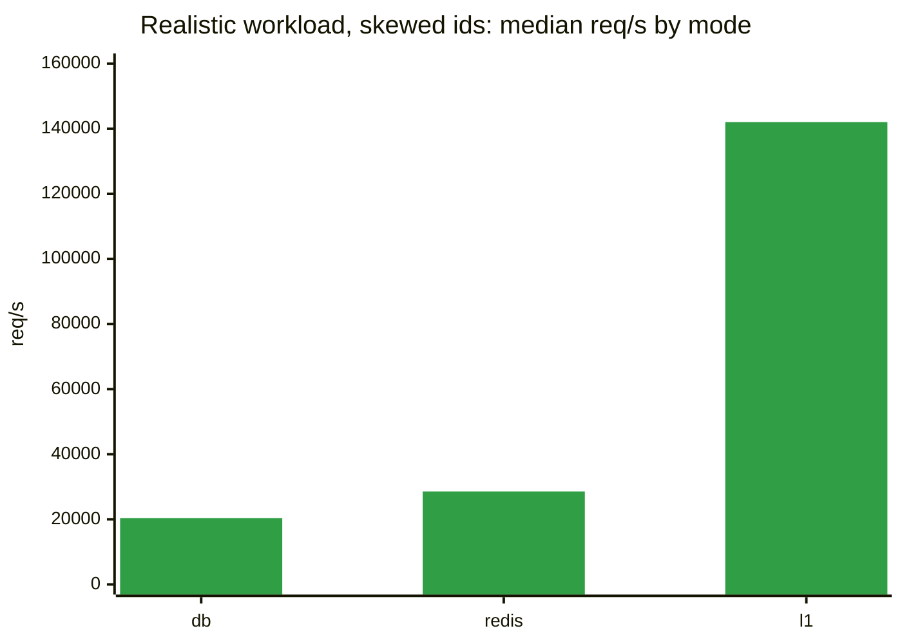

# Evals: scaling a Go API, one item at a time

How fast can a small Go + Postgres API go, and what does each optimization actually buy? Every number here comes from the same test: **1,000,000 requests to a single item**, `GET /items/1`.

## Summary

| Stage | What changed | req/s | p99 | vs baseline | vs previous |
|---|---|---|---|---|---|
| 1 | Baseline: every request hits Postgres | 23,809 | 6 ms | 1.00x | - |
| 3 | + Redis cache | 30,303 | 5 ms | 1.27x | 1.27x |
| 4 | + in-process L1 cache + singleflight | 90,921 | 1 ms | 3.82x | 3.00x |
| 4 | same, with 4 load-test workers (`-w 4`) | 200,002 | 1 ms | 8.40x | - |
| ref | `/ping` floor: no Redis, no DB | 76,919 | 1 ms | 3.23x | - |



**In one line:** the database was never the whole story. Redis helped a little (+27%) because every request still pays a network hop; keeping the hot item in the server's own memory removed that hop and gave 3.8x the baseline (8.4x once the load tester had enough threads).

## How to read the numbers

| Term | Meaning |
|---|---|
| **req/s** | Requests the server finishes per second. Higher is better. |
| **p50** | Half of requests are faster than this: the typical request. |
| **p99** | 99% of requests are faster than this. The slowest 1% are above it, so this is the number users notice. |
| **Errors** | Failed requests or non-2xx responses. Any error invalidates a run. |
| `-c` | Concurrent connections (simulated users). |
| `-w` | Worker threads inside autocannon itself. |

Rule of thumb: report **req/s, p99 and errors** together. High req/s with errors or a bad p99 is not a win.

## Test setup

| | |
|---|---|
| Machine | Ryzen 7 7800X3D (8 cores / 16 threads), 31 GB RAM, Windows |
| Where things run | Go server, Postgres, Redis and autocannon all on this one machine |
| Go server | `net/http`, `pgxpool` with `MaxConns = 20`, go-redis `PoolSize = 50` |
| Cache TTLs | L1 in-process: 5 s. Redis: 60 s |
| Request | `GET /items/1` returns `{"id":1,"name":"test"}` (about 143 bytes with headers) |

Standard command, used for every stage unless noted:

```powershell
autocannon -c 100 -a 1000000 http://localhost:8080/items/1
```

Because everything shares one machine, treat the numbers as **relative comparisons between stages**. Final absolute numbers come from AWS, with the load generator on a separate instance.

---

## Stage 1: Baseline (Postgres only)

Every request runs `SELECT id, name FROM items WHERE id=$1`.

| Metric | Value |
|---|---|
| req/s avg / median | 23,809 / 24,511 |
| Latency p50 / p99 | 4 ms / 6 ms |
| Latency avg / max | 3.61 ms / 81 ms |
| Bandwidth | 3.12 MB/s |
| Errors | not captured |
| Time for 1M requests | about 42 s (calculated from avg req/s) |

**Takeaway:** steady and predictable. 100 clients share a pool of 20 database connections, so about 80 requests are always waiting. Little's Law checks out: 100 / 23,809 ≈ 4.2 ms, close to the measured 3.6 ms average.

<details>
<summary>Raw autocannon output</summary>

```
┌─────────┬──────┬──────┬───────┬──────┬─────────┬─────────┬───────┐
│ Stat    │ 2.5% │ 50%  │ 97.5% │ 99%  │ Avg     │ Stdev   │ Max   │
├─────────┼──────┼──────┼───────┼──────┼─────────┼─────────┼───────┤
│ Latency │ 3 ms │ 4 ms │ 5 ms  │ 6 ms │ 3.61 ms │ 0.81 ms │ 81 ms │
└─────────┴──────┴──────┴───────┴──────┴─────────┴─────────┴───────┘
┌───────────┬────────┬─────────┬─────────┬─────────┬─────────┬──────────┬────────┐
│ Stat      │ 1%     │ 2.5%    │ 50%     │ 97.5%   │ Avg     │ Stdev    │ Min    │
├───────────┼────────┼─────────┼─────────┼─────────┼─────────┼──────────┼────────┤
│ Req/Sec   │ 7,523  │ 21,247  │ 24,511  │ 24,927  │ 23,809  │ 2,673.33 │ 7,522  │
├───────────┼────────┼─────────┼─────────┼─────────┼─────────┼──────────┼────────┤
│ Bytes/Sec │ 986 kB │ 2.78 MB │ 3.21 MB │ 3.27 MB │ 3.12 MB │ 350 kB   │ 985 kB │
└───────────┴────────┴─────────┴─────────┴─────────┴─────────┴──────────┴────────┘
```

</details>

---

## Reference: the `/ping` floor

`GET /ping` returns `ok` without touching Redis or Postgres. It shows what Go plus this machine plus autocannon can do at best, so every stage can be judged against it.

| Metric | Value |
|---|---|
| req/s avg / median / peak sample | 76,919 / 71,615 / 102,911 |
| Latency p50 / p99 | 1 ms / 1 ms |
| Latency avg / max | 0.8 ms / 26 ms |
| Time for 1M requests | 13.03 s |

**Takeaway:** the machine is not the limit at 30k req/s. The Redis path reached only about 40% of this floor, which is what pointed at the Redis network hop.

<details>
<summary>Raw autocannon output</summary>

```
┌─────────┬──────┬──────┬───────┬──────┬────────┬─────────┬───────┐
│ Stat    │ 2.5% │ 50%  │ 97.5% │ 99%  │ Avg    │ Stdev   │ Max   │
├─────────┼──────┼──────┼───────┼──────┼────────┼─────────┼───────┤
│ Latency │ 0 ms │ 1 ms │ 1 ms  │ 1 ms │ 0.8 ms │ 0.48 ms │ 26 ms │
└─────────┴──────┴──────┴───────┴──────┴────────┴─────────┴───────┘
┌───────────┬─────────┬─────────┬─────────┬──────────┬───────────┬───────────┬─────────┐
│ Stat      │ 1%      │ 2.5%    │ 50%     │ 97.5%    │ Avg       │ Stdev     │ Min     │
├───────────┼─────────┼─────────┼─────────┼──────────┼───────────┼───────────┼─────────┤
│ Req/Sec   │ 58,207  │ 58,207  │ 71,615  │ 1,02,911 │ 76,919.39 │ 13,178.43 │ 58,197  │
├───────────┼─────────┼─────────┼─────────┼──────────┼───────────┼───────────┼─────────┤
│ Bytes/Sec │ 6.87 MB │ 6.87 MB │ 8.45 MB │ 12.1 MB  │ 9.08 MB   │ 1.56 MB   │ 6.87 MB │
└───────────┴─────────┴─────────┴─────────┴──────────┴───────────┴───────────┴─────────┘

1000k requests in 13.03s, 118 MB read
```

</details>

---

## Stage 3: + Redis cache

Request path: Redis, then Postgres on a miss, then write back to Redis (60 s TTL). 404s are not cached.

| Run | req/s avg | p50 | p99 | Latency avg | Max | Errors |
|---|---|---|---|---|---|---|
| `-c 100` | 30,303 | 3 ms | 5 ms | 2.75 ms | 37 ms | none printed |
| `-c 200` | 30,305 | 6 ms | 9 ms | 5.9 ms | 213 ms | not captured |
| `-c 100 -w 4` | 29,413 | 3 ms | 5 ms | 2.81 ms | 42 ms | none printed |

Fair comparison with Stage 1 (both `-c 100`): **23,809 to 30,303 req/s (+27%)**, p99 6 ms to 5 ms.

**Takeaway:** throughput stayed at about 30k whether the test used 100 or 200 connections, or 1 or 4 tester threads. Only latency changed (Little's Law: 100 / 30,303 ≈ 3.3 ms). A flat ceiling like that means one fixed cost per request, which here is the network round trip to Redis.

<details>
<summary>Raw autocannon output (-c 100)</summary>

```
┌─────────┬──────┬──────┬───────┬──────┬─────────┬─────────┬───────┐
│ Stat    │ 2.5% │ 50%  │ 97.5% │ 99%  │ Avg     │ Stdev   │ Max   │
├─────────┼──────┼──────┼───────┼──────┼─────────┼─────────┼───────┤
│ Latency │ 1 ms │ 3 ms │ 5 ms  │ 5 ms │ 2.75 ms │ 0.98 ms │ 37 ms │
└─────────┴──────┴──────┴───────┴──────┴─────────┴─────────┴───────┘
┌───────────┬─────────┬─────────┬─────────┬─────────┬──────────┬──────────┬─────────┐
│ Stat      │ 1%      │ 2.5%    │ 50%     │ 97.5%   │ Avg      │ Stdev    │ Min     │
├───────────┼─────────┼─────────┼─────────┼─────────┼──────────┼──────────┼─────────┤
│ Req/Sec   │ 14,895  │ 14,895  │ 30,799  │ 32,383  │ 30,303.4 │ 3,050.26 │ 14,890  │
├───────────┼─────────┼─────────┼─────────┼─────────┼──────────┼──────────┼─────────┤
│ Bytes/Sec │ 2.14 MB │ 2.14 MB │ 4.44 MB │ 4.67 MB │ 4.36 MB  │ 439 kB   │ 2.14 MB │
└───────────┴─────────┴─────────┴─────────┴─────────┴──────────┴──────────┴─────────┘
```

</details>

---

## Stage 4: + in-process L1 cache + singleflight

Request path: **L1 (server memory, 5 s TTL)**, then Redis, then Postgres. `singleflight` makes simultaneous misses for the same key share one Redis/DB call.

| Run | req/s avg | req/s median | p50 | p99 | Latency avg | Max | Time for 1M |
|---|---|---|---|---|---|---|---|
| `-c 100` | 90,921 | 99,391 | 0 ms | 1 ms | 0.39 ms | 31 ms | 11.03 s |
| `-c 100 -w 4` | 200,002 | 243,711 | 0 ms | 1 ms | 0.06 ms | 13 ms | 5.02 s |

No error or non-2xx lines were printed. Responses are 143 bytes.

- vs Stage 1: **3.8x** (`-c 100`), **8.4x** (`-w 4`)
- vs Stage 3: **3.0x**

**Takeaway:** a cache hit is now a map lookup in the server's own memory, with no network at all. The ceiling moved from the server to the load tester: single-threaded autocannon tops out near 100k req/s, and with 4 workers it reaches about 250k.

<details>
<summary>Raw autocannon output (-c 100)</summary>

```
┌─────────┬──────┬──────┬───────┬──────┬─────────┬─────────┬───────┐
│ Stat    │ 2.5% │ 50%  │ 97.5% │ 99%  │ Avg     │ Stdev   │ Max   │
├─────────┼──────┼──────┼───────┼──────┼─────────┼─────────┼───────┤
│ Latency │ 0 ms │ 0 ms │ 1 ms  │ 1 ms │ 0.39 ms │ 0.57 ms │ 31 ms │
└─────────┴──────┴──────┴───────┴──────┴─────────┴─────────┴───────┘
┌───────────┬─────────┬─────────┬─────────┬──────────┬──────────┬───────────┬─────────┐
│ Stat      │ 1%      │ 2.5%    │ 50%     │ 97.5%    │ Avg      │ Stdev     │ Min     │
├───────────┼─────────┼─────────┼─────────┼──────────┼──────────┼───────────┼─────────┤
│ Req/Sec   │ 11,271  │ 11,271  │ 99,391  │ 1,04,639 │ 90,921.1 │ 25,688.42 │ 11,266  │
├───────────┼─────────┼─────────┼─────────┼──────────┼──────────┼───────────┼─────────┤
│ Bytes/Sec │ 1.61 MB │ 1.61 MB │ 14.2 MB │ 15 MB    │ 13 MB    │ 3.67 MB   │ 1.61 MB │
└───────────┴─────────┴─────────┴─────────┴──────────┴──────────┴───────────┴─────────┘

1000k requests in 11.03s, 143 MB read
```

</details>

<details>
<summary>Raw autocannon output (-c 100 -w 4)</summary>

```
┌─────────┬──────┬──────┬───────┬──────┬─────────┬─────────┬───────┐
│ Stat    │ 2.5% │ 50%  │ 97.5% │ 99%  │ Avg     │ Stdev   │ Max   │
├─────────┼──────┼──────┼───────┼──────┼─────────┼─────────┼───────┤
│ Latency │ 0 ms │ 0 ms │ 1 ms  │ 1 ms │ 0.06 ms │ 0.28 ms │ 13 ms │
└─────────┴──────┴──────┴───────┴──────┴─────────┴─────────┴───────┘
┌───────────┬─────────┬─────────┬──────────┬──────────┬────────────┬───────────┬─────────┐
│ Stat      │ 1%      │ 2.5%    │ 50%      │ 97.5%    │ Avg        │ Stdev     │ Min     │
├───────────┼─────────┼─────────┼──────────┼──────────┼────────────┼───────────┼─────────┤
│ Req/Sec   │ 16,975  │ 16,975  │ 2,43,711 │ 2,52,543 │ 2,00,001.6 │ 91,684.95 │ 16,962  │
├───────────┼─────────┼─────────┼──────────┼──────────┼────────────┼───────────┼─────────┤
│ Bytes/Sec │ 2.43 MB │ 2.43 MB │ 34.9 MB  │ 36.1 MB  │ 28.6 MB    │ 13.1 MB   │ 2.43 MB │
└───────────┴─────────┴─────────┴──────────┴──────────┴────────────┴───────────┴─────────┘

1000k requests in 5.02s, 143 MB read
```

</details>

---

## Realistic workload: 10,000 items, random ids

Same server, switched between stages with `CACHE_MODE=db|redis|l1`. Each run is `node multi.js` (4 copies x 100 connections = 400 connections, 1,000,000 requests), 3 runs per cell, median reported. Redis is flushed before each cell, so run 1 of every cell starts cold.

- **skewed:** about 46% of requests go to the first 10% of ids (a few popular items).
- **uniform:** every id equally likely.

| Mode | Workload | Runs (req/s) | Median req/s | vs db | Median p99 | Errors |
|---|---|---|---|---|---|---|
| db (Postgres only) | skewed | 20,392 / 20,816 / 19,220 | **20,392** | 1.00x | 28 ms | 0 |
| db (Postgres only) | uniform | 21,263 / 20,396 / 20,392 | **20,396** | 1.00x | 25 ms | 0 |
| redis | skewed | 27,755 / 28,539 / 28,539 | **28,539** | 1.40x | 26 ms | 0 |
| redis | uniform | 27,747 / 27,755 / 28,547 | **27,755** | 1.36x | 28 ms | 0 |
| l1 (L1 + Redis + singleflight) | skewed | 124,378 / 142,045 / 142,045 | **142,045** | 6.97x | 6 ms | 0 |
| l1 (L1 + Redis + singleflight) | uniform | 124,378 / 142,045 / 142,045 | **142,045** | 6.96x | 6 ms | 0 |



**Takeaways**

- Same ranking as the single-item test: L1 is about **7x** Postgres and about **5x** Redis. Redis alone gives only about 1.4x, because every hit still pays a network round trip.
- p99 (worst of the 4 tester copies, 400 connections): 25-28 ms for db and redis, 6 ms for l1.
- Skewed and uniform give the same result in every mode. With only 10,000 ids and 142k req/s, each id is requested about 14 times a second, so even a 5 s L1 TTL leaves only a small share of requests as misses. This keyspace is too small to stress the cache.
- Results repeat (124,378 / 142,045) because autocannon measures duration in whole seconds, and a 1M-request L1 run lasts only about 7 s. One second is about 12%, so use more requests per run for the L1 stage.
- Run 1 of each L1 cell took about 1 s longer than the rest: the cold-cache penalty.
- 0 errors, 0 non-2xx and 0 timeouts in all 18 runs.

Not measured: actual cache hit ratios (use `redis-cli info stats` before and after a run).

---

## What these results do and don't show

**They show:**
- Where the time goes at each stage (DB round trip, then Redis network hop, then the load tester).
- That caching tiers pay off in proportion to how much network they remove.

**They don't show (yet):**
- **A large keyspace.** The single-item results are a best case. The 10,000-id runs are more realistic, but still small enough that L1 holds nearly every id. A million-id dataset would show real miss behavior.
- **Absolute production numbers.** Everything shares one machine, so the load tester takes CPU from the server.
- **Steady state.** Runs last 5-34 s. The first one-second sample is warm-up (it is the min req/s in each table), so medians are closer to the true rate than averages.
- **Cache growth limits.** The L1 map has no size cap or eviction, which is fine for one key but not for millions.

## Next

1. Bigger keyspace: seed 1M rows and re-run uniform, to see real L1/Redis miss behavior and the need for eviction (ristretto or otter). Also record measured hit ratios.
2. Re-run Stage 1 with `-w 4` so every stage uses matching flags.
3. Docker, then AWS: load test from a separate instance, then several instances behind a load balancer.